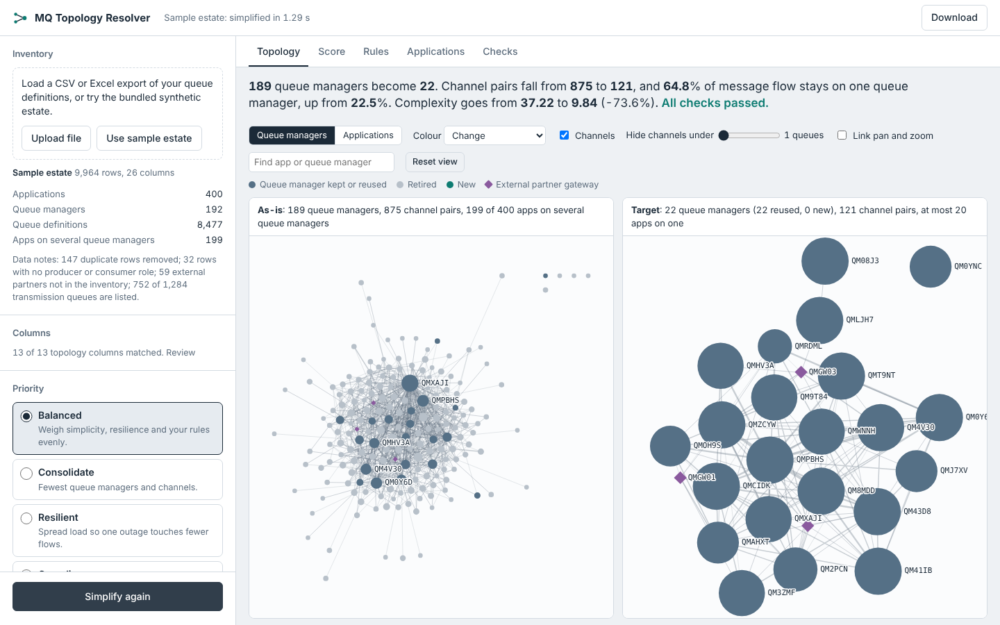

# MQ Topology Resolver

Turn an as-is IBM MQ inventory into a simpler target topology. Every application ends up on one queue manager, the rules you set are kept, and you get the before and after side by side, a complexity score you can check, and the target in your own file format.



## What it does

1. **Reads your inventory** (CSV or Excel, one row per queue definition) and maps your column names onto a neutral schema. Your file is written back in its own columns and spellings.
2. **Places every application on one queue manager.** Louvain community detection groups apps that exchange the most messages; hard rules are applied before clustering, oversized groups are split, and a local search moves apps while the complexity score falls.
3. **Generates the target**: local queues, remote queues, transmission queues and sender/receiver channel pairs, plus an MQSC script.
4. **Checks it independently**: every app on one queue manager, every remote queue resolving, every channel paired, every as-is flow still deliverable, every hard rule holding.
5. **Scores both states** with the Topology Complexity Index (0 to 100, lower is simpler) and shows the target against two extremes (one shared queue manager, one queue manager per app).

## Run it on your computer

You need Python 3.10 or newer.

**Windows (PowerShell)**

```powershell
cd D:\Projects\mq-topology-resolver
python -m venv .venv
.venv\Scripts\Activate.ps1
pip install -e ".[server]"
mqresolver serve
```

**macOS or Linux**

```bash
python3 -m venv .venv && source .venv/bin/activate
pip install -e ".[server]"
mqresolver serve
```

Open <http://127.0.0.1:8000> and choose **Run the sample estate**, or upload your own file.

### Command line

```bash
mqresolver run data/sample/mq_topology_sample.csv --out out/
mqresolver run my_export.xlsx --mapping config/examples/mapping.yaml --config config/examples/compliance.yaml --out out/
mqresolver inspect my_export.csv          # columns, attributes and suggested rules
mqresolver sample --apps 1000 --qms 400 --out big.csv
```

`out/` gets `target_topology.csv` (your format), `target_channels.csv`, `target.mqsc`, `report.json`, `decisions.json` and `graph.json`.

## Your own inventory

Required columns: queue name, queue type (Local, Remote, Alias, or QLOCAL style), queue manager and application id. Producer/consumer role and partner names, remote queue manager and name, alias target and usage make the result much better. Any other column that has one value per application (domain, criticality, hosting and so on) becomes an attribute your rules can use. Full schema: [docs/DATA_SCHEMA.md](docs/DATA_SCHEMA.md).

If your headers differ, the UI proposes a mapping for you to confirm, and the CLI takes a mapping file like [config/examples/mapping.yaml](config/examples/mapping.yaml).

## Rules and priorities

A run is configured by a priority profile and a list of rules. Each rule is **hard** (must hold), **soft** (traded against simplicity, with a weight) or **off**.

| Rule | Meaning |
|---|---|
| `capacity` | At most N apps and/or queues per queue manager |
| `isolate` | Matching apps each get their own queue manager |
| `homogeneous` | Apps on one queue manager share an attribute value |
| `separate` | Apps with different values of an attribute never share a queue manager |
| `colocate` | Matching apps share one queue manager |
| `pin` | Matching apps stay on a named queue manager |
| `qm_count` | Minimum and/or maximum number of queue managers |

Profiles: `balanced`, `consolidate`, `resilient`, `compliance`. Examples are in [config/examples](config/examples). The UI suggests rules from your data. Contradictory hard rules stop the run with a message naming the rules involved.

## How the score works

The Topology Complexity Index combines simplicity (routing depth, application sprawl, channel load, plumbing objects, queue manager footprint), resilience (blast radius) and your soft rules, weighted by the profile. The optimiser minimises the same number that is reported, and every report shows the score under all four profiles. Details: [docs/SCORING.md](docs/SCORING.md).

## Deploy and share a link

The repository includes a `Dockerfile` and a Render Blueprint (`render.yaml`).

1. Push the repository to GitHub.
2. In [Render](https://render.com), choose **New > Blueprint**, connect GitHub and pick the repository.
3. Render builds the image and gives you a link such as `https://mq-topology-resolver.onrender.com`.

On the free plan the service sleeps after 15 minutes without traffic and takes about a minute to wake. It has 512 MB of memory, which comfortably fits estates of up to about 2,000 applications; use the command line or a larger instance for bigger ones. Settings: `MQR_MAX_UPLOAD_MB` (default 30) and `MQR_MAX_PARALLEL_RUNS` (default 1).

Uploaded inventories are processed in memory and never stored or logged.

## Tests

```bash
pip install -e ".[dev]"
pytest -m "not slow and not ui"    # quick: engine, API, pipeline
pytest                              # everything, including 2,500-app estates and browser tests
python scripts/run_scenarios.py --large   # writes docs/SCENARIO_RESULTS.md
```

Browser tests need `pip install playwright && playwright install chromium`; they are skipped otherwise. Results across eight contrasting estates and up to thirteen rule sets are in [docs/SCENARIO_RESULTS.md](docs/SCENARIO_RESULTS.md).

## Known limits

- Flow weight is the number of queues between two apps, not message volume.
- High availability, disaster recovery and network zones are not modelled unless you express them as attributes and rules.
- The target uses explicit channels; MQ clusters in the as-is estate are read but not reproduced.
- Strictly one queue manager per application. Apps that deliberately run active-active on several queue managers need an exception rule (not yet built).
- A soft `pin` is only honoured when the named queue manager hosts other apps in the target; use a hard pin to create it.

## Project documents

[Problem analysis](docs/PROBLEM_ANALYSIS.md), [design](docs/DESIGN.md), [scoring](docs/SCORING.md), [data schema](docs/DATA_SCHEMA.md), [implementation plan](docs/IMPLEMENTATION_PLAN.md), [scenario results](docs/SCENARIO_RESULTS.md).
